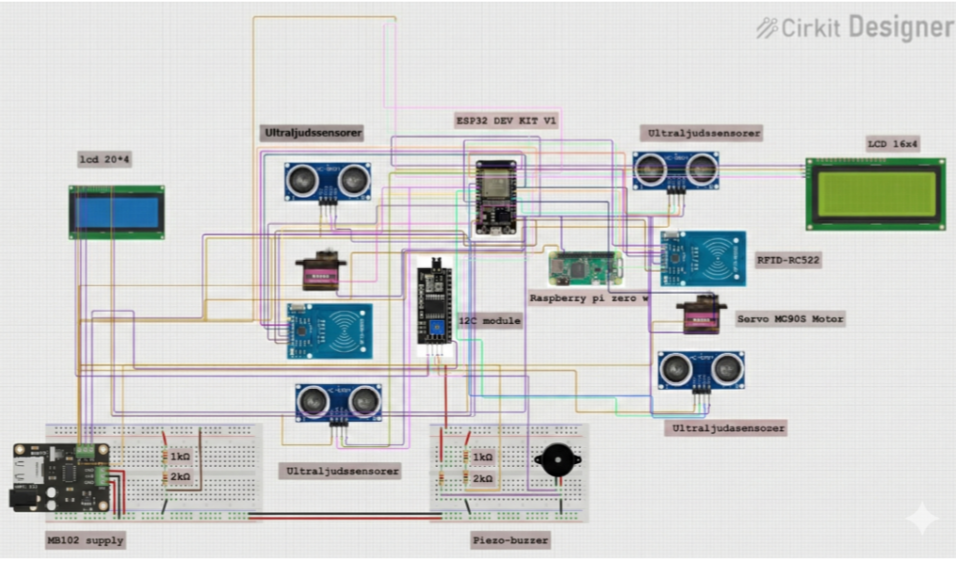
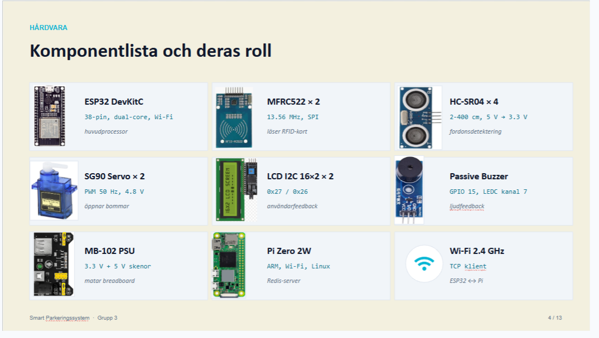
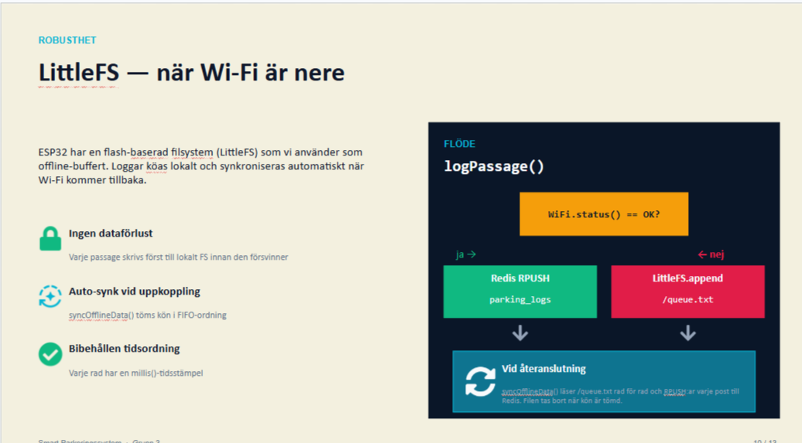

# Automated IoT Smart Parking System with MQTT and Edge Resilience

A complete parking gate system: an ESP32 at the gates (RFID readers, ultrasonic
sensors, servo barriers, LCDs, buzzer), an MQTT broker, a backend with a
database, and an admin dashboard. The gates keep working during a network
outage and deliver everything they recorded once the connection is back.

[Prototype video](https://drive.google.com/file/d/1zMqwTUaIUi8lEEkRGk4BoZeTIl_LKmPN/view)

## Purpose

Finding a free space, queuing at the gate and badly used lots are everyday
parking problems. This project automates entry and exit with RFID, shows live
availability at the gate and in a dashboard, and is built so that a Wi-Fi or
server failure never stops the barriers (edge computing + store & forward).

## What is in the box

| Layer | Where | What it does |
| --- | --- | --- |
| **Edge / sensors** | `src/main.cpp` (PlatformIO, ESP32-S3) | Reads 2 RFID readers and 4 ultrasonic sensors, drives 2 servo barriers, 2 LCDs and a buzzer. Decides access locally from a card list in flash. Buffers events in LittleFS when offline. |
| **Messaging** | MQTT (built-in broker, or Mosquitto via Docker) | Events, status, card list, commands. Contract in [`docs/MQTT_TOPICS.md`](docs/MQTT_TOPICS.md). |
| **Backend** | `backend/src` (Node.js) | Stores events, keeps the device's card list in sync, acknowledges events, relays admin commands, REST API + live updates. |
| **Database** | SQLite file `backend/data/parking.db` | Cards, activity log, occupancy history, settings. |
| **Dashboard** | `backend/public` (plain HTML/CSS/JS) | Live lot view, activity log, card management, statistics, settings, remote gate control. Works without internet. |
| **Simulator** | `backend/src/simulator.js` + "Test bench" tab | A virtual ESP32 that speaks the same MQTT protocol, so every feature can be tested without hardware. |

```
 ESP32 gate controller                Server (PC or Raspberry Pi)
┌──────────────────────────┐        ┌──────────────────────────────────────┐
│ 2x RFID   4x ultrasonic  │        │  MQTT broker :1883                   │
│ 2x servo  2x LCD  buzzer │  MQTT  │      │                               │
│                          │◄──────►│  Backend (Node.js) ── SQLite         │
│ card list in flash       │ Wi-Fi  │      │                               │
│ offline queue in flash   │        │  Dashboard http://<server>:8080      │
└──────────────────────────┘        └──────────────────────────────────────┘
```

## Quick start (no hardware needed)

You need [Node.js 22.13 or newer](https://nodejs.org).

```bash
cd backend
npm install
npm start
```

Open <http://localhost:8080> and sign in with the password `admin`.

The backend starts its own MQTT broker on port 1883 and a virtual gate
controller. Go to the **Test bench** tab and click **Drive a car in**. Then
follow [`docs/TEST_PLAN.md`](docs/TEST_PLAN.md) to try every feature, including
the network outage.

`npm test` runs the automated end-to-end tests.

### Settings (environment variables)

| Variable | Default | Meaning |
| --- | --- | --- |
| `PORT` | `8080` | Dashboard and API port |
| `ADMIN_PASSWORD` | `admin` | Dashboard password. Change it for real use. |
| `MQTT_URL` | empty | Empty = use the built-in broker. Set e.g. `mqtt://localhost:1883` to use Mosquitto instead. |
| `MQTT_PORT` | `1883` | Port of the built-in broker |
| `SIMULATOR` | `on` | `off` removes the virtual gate controller |
| `DATA_DIR` | `backend/data` | Where the database is stored |

Windows PowerShell example: `$env:ADMIN_PASSWORD="my-secret"; npm start`

## Running on the Raspberry Pi with Docker

```bash
cp .env.example .env        # set ADMIN_PASSWORD
docker compose up -d --build
```

This starts Mosquitto (port 1883) and the backend + dashboard (port 8080). Data
is kept in Docker volumes.

## Connecting the real ESP32

1. Copy `include/secrets.example.h` to `include/secrets.h` and fill in the Wi-Fi
   name, password and the IP address of the server (shown in the dashboard under
   Settings → "ESP32 connects to"). `secrets.h` is ignored by git.
2. In the dashboard, switch the simulator **Power** off (Test bench tab).
3. Open the project in PlatformIO and upload (`env:esp32s3`).
4. Serial monitor at 115200 baud. Type `help` for diagnostic commands.

The header of the dashboard shows "Gate controller online (esp32-gate)" when it
is connected. Register your cards under **Cards**, or scan an unknown card and
click **Register this card** in the Activity tab.

### Wiring (Freenove ESP32-S3, as in `src/main.cpp`)

| Part | Pins |
| --- | --- |
| RFID RC522 entry / exit (SPI) | SCK 12, MISO 13, MOSI 11, RST 5, SS entry 10, SS exit 6 |
| LCD 16x2 entry / exit (I2C) | address 0x27 / 0x26 |
| Servo entry / exit | 4 / 18 (powered from the MB102 5 V rail, common ground) |
| Buzzer | 3 |
| Ultrasonic entry before / after | TRIG 16 ECHO 17 / TRIG 7 ECHO 15 |
| Ultrasonic exit before / after | TRIG 20 ECHO 21 / TRIG 8 ECHO 9 |

HC-SR04 echo pins are 5 V: use the 1 kΩ / 2 kΩ voltage dividers shown in the
circuit diagram.

<p align="center"></p>
<p align="center"></p>

`diagram.json` (Wokwi) still describes the older ESP32 DevKit wiring, not the
S3 pin numbers above.

## How it behaves

**Edge first.** The ESP32 holds the list of active cards in flash and decides
by itself whether to open. The server is never asked at scan time, so the gate
answers instantly and keeps answering when the network is gone.

**Store & forward.** Every event gets a unique id. It stays on the device until
the backend acknowledges it; without an acknowledgement it is written to
`/offline_queue.txt` in LittleFS and re-sent after reconnecting. The backend
stores each id once, so nothing is lost and nothing is counted twice. The
occupancy counter and the card list survive a power cut.

**Safe barriers.** After a card is accepted the barrier opens. It closes when
the "after" sensor has seen the vehicle and reports clear several times in a
row, or after 15 s if nobody drove through. It never closes while something is
under it.

**Non-blocking network.** Wi-Fi reconnects in the background and broker
retries are short and spaced out, so card reading is not frozen while the
network is down.

**Time without internet.** The backend publishes the time over MQTT, so events
get real timestamps on an isolated LAN. Events recorded before the device ever
saw the time are marked "time is approximate".

<p align="center"></p>

## Dashboard

* **Lot strip**: free spaces, bays, both barriers live, remote open buttons.
* **Activity**: entries, exits, denied scans and admin actions, with filter, search and CSV export. Events that were buffered during an outage are tagged.
* **Cards**: add, edit, block, unblock, delete. Shows who is inside, visits and last seen.
* **Statistics**: counts, occupancy over time, vehicles in/out, who is inside, top visitors, denial reasons.
* **Test bench**: the virtual gate controller with LCDs, sensors, card reader, power and network switches.
* **Settings**: capacity, counter correction, device details.

## Project layout

```
src/main.cpp              ESP32 firmware
include/secrets.example.h Wi-Fi + broker settings template
platformio.ini            PlatformIO build configuration
backend/src/              index.js, app.js, parking.js (MQTT), server.js (HTTP), db.js, simulator.js
backend/public/           dashboard
backend/test/             end-to-end tests
docker-compose.yml        Mosquitto + backend for the Raspberry Pi
mosquitto/                broker configuration
docs/                     MQTT contract, manual test plan, diagrams
```

## Challenges and solutions

| Challenge | Solution |
| --- | --- |
| 3.3 V logic vs 5 V sensors | 1 kΩ / 2 kΩ voltage dividers on the echo pins |
| Brown-out resets when the servos move | Separate MB102 supply for the servos, common ground, decoupling capacitors |
| Data loss during a network outage | Store & forward in LittleFS with acknowledgements and duplicate protection |
| Gates freezing while Wi-Fi reconnects | Background reconnect, short and spaced-out broker retries |
| No clock without internet | Time published by the backend over MQTT |

## Security notes

* Change `ADMIN_PASSWORD` before using this outside a test bench.
* The broker accepts anonymous clients, which is fine on a private LAN only. `mosquitto/mosquitto.conf` explains how to add a password.
* RFID UIDs can be cloned; UID matching is suitable for a school project, not for a high-security site.

## Future development

* Mobile app for booking and navigation
* Per-bay sensors so the dashboard shows exactly which bay is free
* Licence plate recognition
* EV charging status
* Occupancy prediction

Author: Jubayer Alam Akanda
